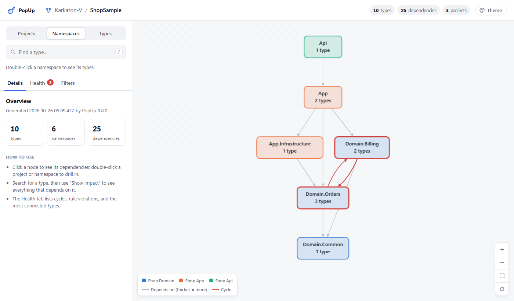
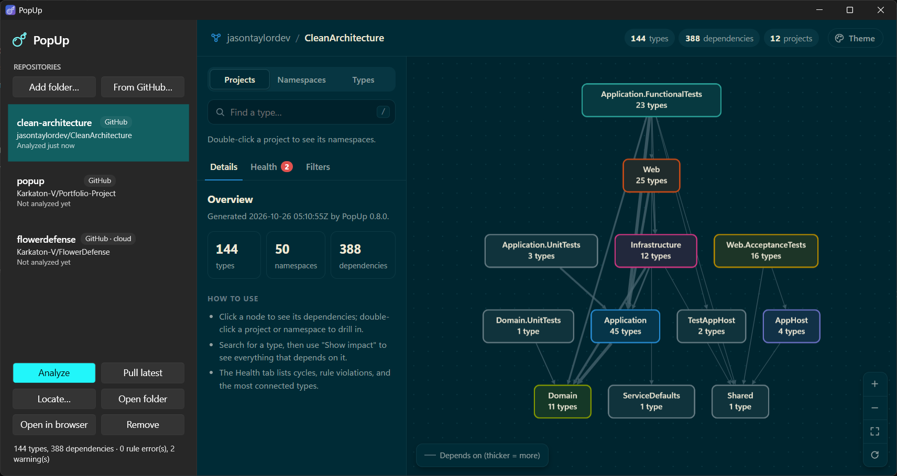
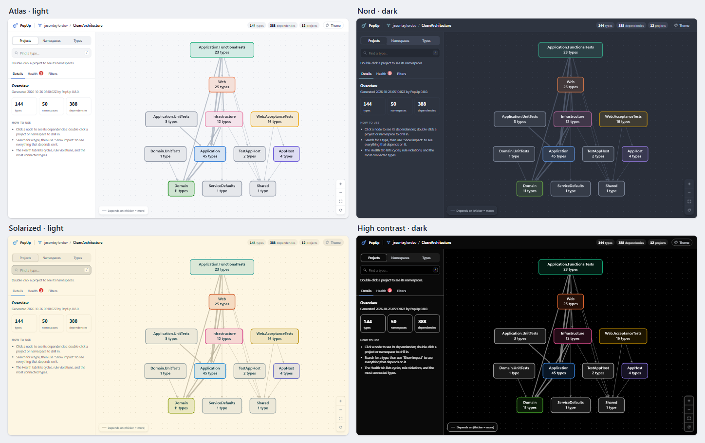

# PopUp

[](https://github.com/Karkaton-V/Portfolio-Project/actions/workflows/ci.yml)

A command-line tool and Windows desktop app that map the dependencies inside a C# solution using the Roslyn compiler APIs, then
finds dependency cycles, answers "what could this change affect?", enforces architecture rules in CI, and
writes an interactive HTML report you can explore in any browser.

The name is a nod to bubble charts (hence the bubble logo): change a type and PopUp shows what pops up, meaning
everything that depends on it, along with the cycles and rule violations worth popping.

> PopUp was called CodeAtlas, then Burndown, during v0.8. Older setups keep working: `codeatlas.json` and
> `burndown.json` files are still read, `~/.codeatlas` or `~/.burndown` is moved to `~/.popup` the first time PopUp
> runs, and `CODEATLAS_*` or `BURNDOWN_*` environment variables still apply when the matching `POPUP_*` one isn't set.

PopUp loads a `.sln`, `.slnx`, or `.csproj`, finds every type the solution declares, and records how those
types depend on each other, from inheritance and constructor injection down to individual method calls.



**Real-world test:** [case study on jasontaylordev/CleanArchitecture](docs/case-studies/clean-architecture/README.md)
(13 projects, 144 types): its layering rules pass, it has two deliberate cycles, and the run found three bugs in PopUp that are now fixed.

## Use it on your own solution

PopUp works on any C# solution. From the root of a repository:

```bash
popup init      # finds the solution, guesses its layers from project names, writes popup.json
popup check     # enforces those rules
popup report    # writes popup-report.html
```

Every command takes an optional input: a folder (default: the current one), a `.sln`, `.slnx`, or `.csproj`, or
a saved `graph.json`. A folder is searched for its solution, including a few levels down, so a repository with
its solution in `src/` works from the root. When both `App.sln` and `App.slnx` exist, the newer `.slnx` is used.

`init` sorts projects into layers by the conventions most .NET solutions follow (Domain/Core,
Application/Services, Infrastructure/Persistence/Data, Web/Api/UI, and test projects) and writes the usual
layering rules for the layers it finds. It then checks the solution against them, so the first run shows where
things stand. Projects whose names fit no convention are listed in the file for you to place. On
jasontaylordev/CleanArchitecture, `init` produced the same four rules as the hand-written
[case study](docs/case-studies/clean-architecture/popup.json), and all of them pass.

`popup.json` is found in the input's folder or any parent up to the repository root, the way
`.editorconfig` is. Use `exclude` (or `--exclude`) to leave projects out, such as tests or samples:

```bash
popup report --exclude "*Tests,Samples.*"
```

To run PopUp as a command, install the .NET tool from a local build:

```bash
dotnet pack src/PopUp.Cli -o artifacts
```

```bash
dotnet tool install --global --add-source artifacts PopUp.Tool
```

Or run it from source with `dotnet run --project src/PopUp.Cli -- <command>`.

## Desktop app

PopUp also ships as a Windows desktop app that keeps a list of repositories and shows each one's report, so
you can switch between projects without remembering paths or commands.



- **Add folder…** saves any folder with a C# solution. **From GitHub…** lists the repositories you own,
  collaborate on, or can see through an organization (C# ones first), and adds the one you pick.
- **Finds the copy you already have.** Before downloading anything, PopUp looks for an existing clone in the
  folders GitHub Desktop and Visual Studio use by default (`Documents\GitHub`, `source\repos`, and a few others),
  matching each clone's `origin` remote. Clones found this way are marked "On this PC" in the picker and are used
  in place. GitHub Desktop doesn't offer a public way to read its own repository list, so this search covers the
  folders it clones into. If a repository is somewhere else, or moved, **Locate…** points PopUp at it, and
  warns if the folder is a clone of a different repository.
- **Analyzes on GitHub when it can't here.** If a GitHub repository has no copy on this computer (or analyzing
  it here fails, say because the .NET SDK is missing), PopUp runs the analysis on GitHub's servers instead:
  it starts the [`popup-analyze`](.github/workflows/popup-analyze.yml) workflow, follows its progress,
  and downloads the report it produces. If both fail, the app shows both errors.
- **Analyze** (F5) refreshes the report, **Pull latest** updates a downloaded copy first, and **Remove** can
  also delete a copy PopUp downloaded (never a folder you added yourself).

Everything is kept in `%USERPROFILE%\.popup`: the list (`repos.json`), downloaded copies (`repos\owner\name`),
and the latest report for each repository. If the list can't be read, the app offers to set it aside and start
fresh rather than refusing to open. Set `POPUP_HOME` to keep it somewhere else.

GitHub access uses your existing sign-in: the `GH_TOKEN` or `GITHUB_TOKEN` environment variable, or the
[GitHub CLI](https://cli.github.com/) (`gh auth login`). PopUp never saves the token.

**About the GitHub fallback.** The workflow runs in a "runner" repository you control, by default
`Karkaton-V/Portfolio-Project`. To use your own, fork this repository and set `{ "runner": "you/Portfolio-Project" }`
in `.popup\settings.json` (or the `POPUP_RUNNER` environment variable). The run uses that repository's
Actions minutes. It can read public repositories and the runner itself; to analyze your other private
repositories, add a fine-grained token with read access to them as the runner's `POPUP_READ_TOKEN` secret.
Reports are kept as a workflow artifact for one day.

To build the app, publish it for Windows:

```bash
dotnet publish src/PopUp.Desktop -c Release -r win-x64 -o artifacts/PopUp
```

This produces `PopUp.exe` plus Roslyn's two `BuildHost` folders, which must stay next to it. CI publishes
the same folder as the `PopUp-desktop-win-x64` artifact. The app needs the .NET 10 runtime, and the .NET SDK
to analyze solutions locally, plus the WebView2 runtime that comes with Windows 11.

The same list is available from the command line, and any command takes `@name` in place of a path:

```bash
popup repos add Karkaton-V/Portfolio-Project   # uses a clone already on this PC, or downloads one
popup repos add ../MyApp --name myapp
popup repos                                     # list them
popup report @myapp
```

## Usage

```bash
# Analyze once and save the graph; the other commands can reuse it without reloading the solution
dotnet run --project src/PopUp.Cli -- analyze samples/ShopSample/ShopSample.sln -o graph.json

dotnet run --project src/PopUp.Cli -- cycles graph.json
dotnet run --project src/PopUp.Cli -- impact graph.json IOrderRepository
dotnet run --project src/PopUp.Cli -- check samples/ShopSample/ShopSample.sln --sarif results.sarif
dotnet run --project src/PopUp.Cli -- report samples/ShopSample/ShopSample.sln -o report.html
```

`samples/ShopSample` is a small three-project solution with deliberate design problems, so the commands have
something to find:

```
$ popup cycles graph.json

Found 1 namespace cycle(s).

Cycle 1: 2 namespaces
  Shop.Domain.Billing
  Shop.Domain.Orders
  Loop: Shop.Domain.Billing -> Shop.Domain.Orders -> Shop.Domain.Billing
  Caused by:
    Shop.Domain.Billing.Invoice -[Property]-> Shop.Domain.Orders.Order  Shop.Domain/Billing/Invoice.cs:8
    Shop.Domain.Orders.Order -[Calls]-> Shop.Domain.Billing.TaxCalculator  Shop.Domain/Orders/Order.cs:12
    ...
```

```
$ popup impact graph.json IOrderRepository

Changing Shop.Domain.Orders.IOrderRepository may affect 2 type(s) in: Shop.App (2)

Direct dependents
  Shop.App.Infrastructure.InMemoryOrderRepository  Shop.App/Infrastructure/InMemoryOrderRepository.cs:5
    via InMemoryOrderRepository -[Implements]-> IOrderRepository
  Shop.App.OrderService  Shop.App/OrderService.cs:12
    via OrderService -[ConstructorParameter]-> IOrderRepository
```

| Command | Options |
| --- | --- |
| `init [input]` | `--force` replace an existing popup.json |
| `analyze [input]` | `-o <file>` save the graph as JSON |
| `cycles [input]` | `--level namespace` (default) or `--level type` |
| `impact [input] <type>` | `--depth <n>` limit the steps; `--kinds Calls,Implements` follow only some dependency kinds |
| `check [input]` | `--sarif <file>`; `--path-prefix <dir>` |
| `report [input]` | `-o <file>` (default `popup-report.html`); `--title <text>`; `--theme atlas\|nord\|solarized\|contrast` |
| `repos` | list saved repositories; `repos add <folder\|owner/name>` (`--name`, `--clone` to download even if a copy exists, `--no-restore`); `repos remove <name>`; `repos locate <name> <folder>`; `repos pull <name>`; `repos github` (`--all` to include non-C#) |
| every command | `--config <file>` (default: found from the input's folder up); `--exclude <globs>` comma-separated project patterns |

`[input]` is a folder (default: the current one), a solution or project, a saved `graph.json`, or `@name` for a
repository saved with `popup repos add`. `<type>` can be
a full name (`Shop.Domain.Orders.Order`), a simple name (`Order`), a namespace suffix (`Orders.Order`), or a type
ID. If the name is ambiguous, PopUp lists the matches with their projects and IDs.

Exit codes: `0` success, `1` bad arguments or config, `2` analysis failed, `3` architecture rules failed.

## Architecture rules

`popup check` enforces rules written in a `popup.json` file, so a layering mistake fails the build
instead of being found in code review months later:

```jsonc
{
  // Layers give names to groups of namespaces.
  "layers": {
    "Domain": ["Shop.Domain.**"],
    "Application": ["Shop.App.**"],
    "Api": ["Shop.Api.**"]
  },
  "rules": [
    { "name": "Domain has no outward dependencies", "from": "Domain", "mayOnlyDependOn": [] },
    { "name": "Application does not depend on the API", "from": "Application", "forbid": ["Api"] },
    { "name": "Services use repositories through interfaces", "from": "Shop.App", "forbid": ["Shop.App.Infrastructure.**"] },
    { "name": "Billing does not depend on Orders", "from": "Shop.Domain.Billing", "forbid": ["Shop.Domain.Orders"], "severity": "warning" }
  ],
  "namespaceCycles": "error"
}
```

```
$ popup check samples/ShopSample/ShopSample.sln

[PASS] Domain has no outward dependencies
[PASS] Application does not depend on the API
[FAIL] Services use repositories through interfaces (1 violation(s))
   Shop.App.OrderService depends on Shop.App.Infrastructure.InMemoryOrderRepository (Instantiates).
     at Shop.App/OrderService.cs:15
[WARN] Billing does not depend on Orders (1 violation(s))
   ...
[FAIL] No namespace cycles (1 violation(s))
   ...
Check failed: 2 error(s), 1 warning(s).
```

| Setting | Meaning |
| --- | --- |
| `from`, `forbid`, `mayOnlyDependOn` | A layer name, a namespace pattern, or `project:Name` |
| `forbid` | Types in `from` must not depend on any of these |
| `mayOnlyDependOn` | Types in `from` may depend only on these and on `from` itself; `[]` means "only itself" |
| `kinds` | Optional: only check some dependency kinds, e.g. `["Calls", "Instantiates"]` |
| `severity` | `error` (default, fails the check) or `warning` |
| `id` | Optional stable id for SARIF; defaults to a slug of the name |
| `namespaceCycles` | `error` or `warning` to report every namespace cycle; omit to skip |
| `exclude` | Projects to leave out of every command, e.g. `["*Tests", "Samples.*"]` (`*` matches anything, case-insensitive) |
| `report` | Defaults for `popup report`: `{ "title": "...", "theme": "nord" }` |

Namespace patterns: `Shop.Domain` matches exactly; `*` matches within one segment (`Shop.*.Api`); a trailing
`.**` matches the namespace and everything under it.

The config is checked before the (slow) solution load. Misspelled settings are errors rather than being
silently ignored, and a pattern that matches no types is reported, since a typo would otherwise make a rule pass forever.

### SARIF and GitHub code scanning

`--sarif <file>` writes [SARIF 2.1.0](https://docs.oasis-open.org/sarif/sarif/v2.1.0/sarif-v2.1.0.html), the
format GitHub code scanning reads, so violations show up as annotations on pull requests. SARIF paths must be
relative to the repository root. When the input is a solution inside a Git repository, PopUp works out the
prefix itself (e.g. `samples/ShopSample/`); for a saved `graph.json`, pass `--path-prefix`.

To show violations in code scanning, add this after the `check` step in a workflow
(requires `permissions: security-events: write`):

```yaml
- uses: github/codeql-action/upload-sarif@v3
  if: always()
  with:
    sarif_file: results.sarif
```

`.github/workflows/ci.yml` builds and tests PopUp, then runs `check` on the sample and fails unless it
finds the sample's deliberate violations (exit code 3).

## Interactive report

`popup report` writes one self-contained HTML file. The page, its script, Cytoscape.js, and the graph data are
all inlined, so it opens offline, with no server, and can be attached to a CI run or emailed.

- **Where it came from**: the header puts the GitHub owner (linked to the repository) before the title when the
  code is a clone of a GitHub repository, or the parent folder otherwise, each with its own icon.
- **Projects → namespaces → types.** Drawing hundreds of types at once is unreadable, so the report starts at the
  project level (in layered solutions, projects are the layers) and you double-click to drill in. Edges are
  weighted by how many dependencies they carry, and namespace cycles are drawn in red. Add `#level=namespace` or
  `#level=type` to the report's URL to open it on another level.
- **Layered layout**: projects and namespaces are drawn as an architecture diagram. Each one's row is its longest
  dependency chain, so the innermost layer sits at the bottom, and rows are ordered to reduce crossing lines.
  Projects can't form cycles, so their graph is always a DAG; for namespaces, an edge that closes a cycle is ignored
  when ranking.
- **Color means project** at every level, from a fixed, colorblind-checked palette, so a dependency that crosses
  layers is visible as a line between colors. Red is kept out of the palette because it means "cycle".
- **Type view**: double-click a namespace to see its types, plus faded neighbors from other namespaces for context.
  Shape shows the kind of type; dashed edges are inheritance or interface implementation.
- **Hover** a node to preview its connections; **click** to pin the selection. Press `/` to search.
- **Themes**: four color themes (Atlas, Nord, Solarized, High contrast), each with light and dark variants, plus
  an Auto/Light/Dark switch. The report opens in the theme set by `--theme` or `popup.json`. A viewer's own
  pick from the Theme menu is remembered in their browser, and a link like `report.html#theme=nord&mode=dark`
  opens a specific look. Every theme's project palette passes the same colorblind-safety checks against its own
  background in both modes.


- **Details**: click any type for its source locations, coupling (used by, uses, instability), and what it depends
  on and what depends on it, with the kinds of each dependency.
- **Impact**: "Show impact" redraws the graph as rings around the type: direct dependents, then 2 steps away, and so on.
- **Health**: rule results from `popup.json` (when present), namespace cycles, and the most connected types.
- **Filters**: hide noisy dependency kinds (like `References`) or whole projects; search finds any type by name.

The analysis (cycles, coupling, rule results) runs in C#. The page's script only draws and filters. Every name is
inserted as text rather than HTML, and the embedded JSON escapes `<`, so a type name can't inject markup into
the page (there's a test with a hostile name). The page supports light and dark mode and works at phone width.

To keep reports small on big solutions, edges are embedded as number rows that point into node, kind, and file
tables (`[source, target, kind, file, line]`) rather than as objects that repeat full type IDs. On the case-study
solution that cut the embedded data by 70%.

## Performance

`analyze` compiles and extracts every project in parallel, and within a project processes types in parallel.
Roslyn's compilations and semantic models are safe to query from many threads. Results go into a fixed slot per
project and are merged in a fixed order, so the graph is byte-for-byte identical from run to run. On the case-study
solution (13 projects), compiling and extracting went from about 9–11 s to about 3.6 s. Most of the remaining time
is MSBuild evaluating the project files, which PopUp reports separately:

```
  Loaded 13 projects in 10.5 s
  Compiled and extracted dependencies in 3.6 s (14.1 s total, using up to 12 threads)
```

Other choices that keep larger graphs fast:
- **Rule checks:** each selector is resolved to a set of type IDs once, so checking an edge is two hash lookups.
- **Cycle evidence:** gathered in a single pass over the edges.
- **The viewer:** caches its filtered edge list and incoming-edge index between clicks.

## How it works

### Extracting the graph

| Step | Approach | Why |
| --- | --- | --- |
| Load | `MSBuildWorkspace` opens the solution with real project context (references, compiler options) | Semantic analysis needs to know what every name refers to, which reading `.cs` files alone can't provide |
| Find types | Walk namespace **symbols** (`Compilation.Assembly.GlobalNamespace`), not syntax trees | A `partial` class is one symbol across many files, so it becomes one node automatically |
| Identify types | `{assembly}:{documentation comment id}`, e.g. `Shop.Domain:Shop.Data.Repository`1` | Survives across compilations, keeps generic arity, and separates same-named types |
| Declarations | Base type, interfaces, constructor parameters, fields, properties, method signatures | Generic arguments and arrays are unwrapped: `Dictionary<string, List<Order>>` depends on `Order` |
| Bodies | Every name, `new`, and call in method bodies, accessors, lambdas, and initializers is bound with the semantic model | `var x = Load()` resolves to the real return type, and `order.ToDto()` is attributed to the extension class that declares it, not to `Order` |
| Filter | Edges are kept only when the target is a solution type | Framework and NuGet types would otherwise drown the graph |

Each edge records its **kind** (`Inherits`, `Implements`, `ConstructorParameter`, `Field`, `Property`,
`MethodSignature`, `Instantiates`, `Calls`, `References`) and the source line it was first seen on.

### Cycle detection

Cycles are found with **Tarjan's strongly connected components algorithm** in O(V + E). The textbook version is
recursive with depth equal to the longest dependency chain, which can overflow the stack on large graphs, so
`StronglyConnectedComponents` keeps an explicit stack instead (a test runs it on a 200,000-node chain).

Cycles are reported at the **namespace** level by default. Type-level cycles are often fine (an `Order` and its
`OrderLine` pointing at each other), but namespaces that depend on each other usually mean two layers have become
one. Each cycle comes with a shortest example loop (found by breadth-first search) and the type-level edges that cause it.

### Change impact

`ImpactAnalyzer` walks dependency edges **backwards** from the target with a breadth-first search. BFS reaches
types in order of distance, so the first path found to each one is a shortest path, and a visited set keeps
cycles from looping forever. Results are *potentially* affected types: whether a change breaks a dependent depends
on what changed.

### What the analysis won't guess

- **Unresolved types** (usually an unrestored solution) are reported as warnings, and no edges are drawn through them.
- **Project load failures** from MSBuild are reported instead of silently producing a partial graph.
- **Injected source** from outside the solution folder (e.g. the test SDK's `AutoGeneratedProgram`) is excluded.

### Known limitations

Static analysis only sees what the source code says. In the sample, `OrdersController` depends on `IOrderService`,
and only the dependency-injection setup at runtime connects that to `OrderService`. So `impact IOrderRepository`
correctly stops at `OrderService` instead of reaching the controller. Reflection and `dynamic` are invisible for the same reason.

> **Security note:** loading a solution evaluates its MSBuild files, which can run arbitrary build logic.
> Only analyze solutions you trust.

## Project layout

```
src/
  PopUp.Core/        Graph model, JSON, graph algorithms (cycles, impact, coupling), and architecture
                         rules + SARIF; no Roslyn dependency
  PopUp.Analysis/    Roslyn extraction: SolutionAnalyzer -> GraphBuilder -> Dependency/BodyDependencyExtractor
  PopUp.Report/      HTML report writer; Assets/ holds the page, styles, viewer script, and vendored Cytoscape.js
  PopUp.Cli/         The `popup` command
  PopUp.Repos/       Saved repositories, GitHub API client, finding local clones, git, analysis on GitHub Actions
  PopUp.Desktop/     The Windows desktop app (WPF + WebView2, MVVM)
tests/
  PopUp.Analysis.Tests/   Extraction tests that compile C# source strings in memory (no MSBuild needed)
  PopUp.Core.Tests/       Algorithm and rules tests on small hand-built graphs
  PopUp.Report.Tests/     Report tests: self-contained output, embedded data, escaping of hostile names
  PopUp.Repos.Tests/      Registry, clone discovery, and GitHub tests against a fake GitHub API (no network)
samples/
  ShopSample/            A small solution with deliberate rule violations and a popup.json, for demos and CI
```

## Development

```bash
dotnet build
dotnet test
```

Requires the .NET 10 SDK (pinned in `global.json`). The target framework is set once in `Directory.Build.props`.

## Roadmap

- [x] **v0.1** Load solutions, extract types and declaration-level dependencies, export JSON
- [x] **v0.2** Method-body dependencies, namespace and type cycle detection (iterative Tarjan), change-impact analysis
- [x] **v0.3** `popup check`: architecture rules from a config file, non-zero exit code, SARIF output, GitHub Actions CI
- [x] **v0.4** Self-contained interactive HTML report (Cytoscape.js) with coupling metrics
- [x] **v0.5** .NET 10 LTS and Roslyn 5; case study on a real-world solution
- [x] **v0.6** Parallel analysis (~3× faster), compact report data (-70%), redesigned report with layered diagrams, colored CLI output
- [x] **v0.7** Works from any folder, `popup init` generates rules for any solution, project exclusions, config discovery, report themes
- [x] **v0.8** Windows desktop app, saved repositories (`popup repos`, `@name`), GitHub integration that reuses local clones and falls back to analyzing on GitHub Actions
- [ ] **Later** Pull-request impact (`--since main`), analysis history across commits

## Third-party code

The HTML report inlines [Cytoscape.js](https://js.cytoscape.org/) 3.34.3 (MIT License, Copyright (c) 2016-2026
The Cytoscape Consortium); see `src/PopUp.Report/Assets/cytoscape.LICENSE`.
