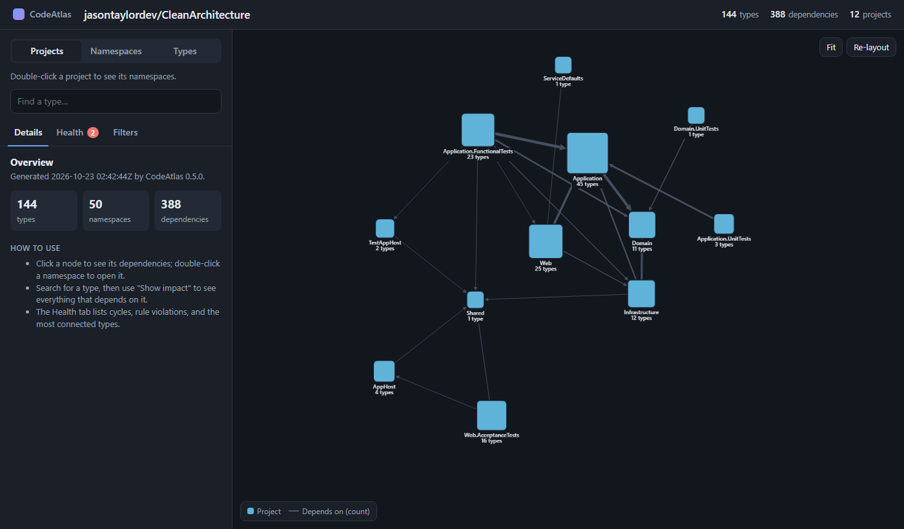
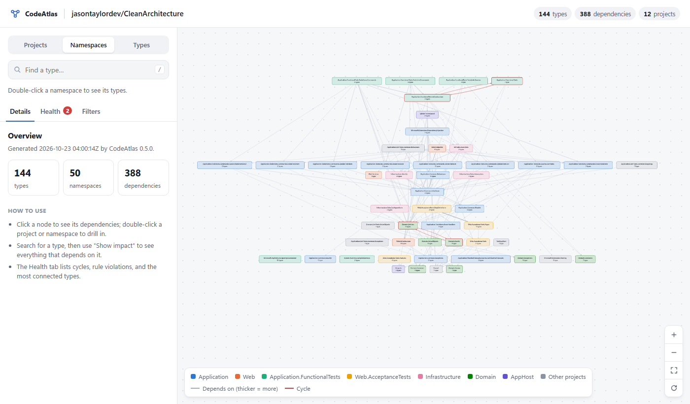

# Case study: jasontaylordev/CleanArchitecture

I ran PopUp on [jasontaylordev/CleanArchitecture](https://github.com/jasontaylordev/CleanArchitecture), a
popular .NET solution template that's built specifically to demonstrate layered architecture. The goal was to
test PopUp on code I didn't write, and to see whether the template follows its own rules.

| | |
| --- | --- |
| Commit analyzed | `968abf7` (2026-10-21) |
| Solution | `CleanArchitecture.slnx`: 13 projects, including .NET Aspire hosts and four test projects |
| Graph | 144 types and 388 dependencies across 12 projects with types (50 namespaces) |
| Analysis time | About 14 s on a laptop: ~10.5 s MSBuild loading the projects, ~3.6 s compiling and extracting in parallel (the first run after a reboot takes longer while MSBuild warms up) |
| Rules | [`popup.json`](popup.json) in this folder |

```bash
dotnet restore CleanArchitecture.slnx
popup analyze CleanArchitecture.slnx -o graph.json
popup check graph.json --config popup.json
popup report graph.json --config popup.json -o report.html
```

The report draws the projects as a layered diagram computed from the code alone: functional tests, then Web,
Infrastructure, Application, and Domain at the bottom. It's the textbook Clean Architecture picture.



Drilling into namespaces keeps the same layering and project colors. The Domain Entities ↔ Events cycle shows
in red near the bottom:



## Findings

### The layering holds

All four layer rules pass:

| Rule | Result |
| --- | --- |
| Domain depends on nothing else | Pass |
| Application depends only on Domain | Pass |
| Infrastructure does not depend on Web | Pass |
| TodoItems features do not depend on TodoLists features (stricter than the template promises) | Pass |

This is what you'd expect from a template whose whole purpose is clean layering. It's also a useful negative
control: a rules engine that flagged violations here would probably be wrong.

### Two namespace cycles, neither a defect

```
CleanArchitecture.Domain.Entities -> CleanArchitecture.Domain.Events -> CleanArchitecture.Domain.Entities
  TodoItem -[Instantiates]-> TodoItemCompletedEvent        src/Domain/Entities/TodoItem.cs:21
  TodoItemCompletedEvent -[ConstructorParameter]-> TodoItem src/Domain/Events/TodoItemCompletedEvent.cs:5
```

This is the domain-events pattern: an entity raises an event, and the event carries the entity. The cycle is a
deliberate design choice, not a mistake, which is why the config reports namespace cycles as warnings here, not errors.

The second cycle is inside the functional-test harness (`FunctionalTestSetup` ↔ `Infrastructure.TestApp`), where
mutual references between test fixtures are normal.

**Takeaway:** cycle detection should surface cycles with evidence and let a person judge them. Treating every
cycle as a failure would have produced two false alarms on a well-designed codebase.

### Change impact

| Changing… | Direct dependents | All potentially affected |
| --- | --- | --- |
| `Domain.Entities.TodoItem` | 17 | 37 types in 6 projects |
| `Application.Common.Interfaces.IApplicationDbContext` | 13 | 28 types in 5 projects |

The most depended-on types are the two entities (`TodoItem`, `TodoList`) and `IApplicationDbContext`, as you'd
expect for a CRUD-style application: every command and query handler goes through the database abstraction.

## What it found in PopUp

Running on real code turned up three problems that the hand-written tests and the sample solution never hit.
Each is now fixed, and the first has a regression test:

1. **False "unresolved type" warning.** The DI setup registers MediatR behaviours with
   `typeof(AuthorizationBehaviour<,>)`. For an unbound generic like that, Roslyn fills the empty type slots with
   placeholder *error* types, which PopUp reported as "2 referenced types could not be resolved (TRequest,
   TResponse)". Unbound generics are now handled as references to the generic type itself.
2. **Indistinguishable duplicate names.** Application, Infrastructure, and Web each declare a class with the identical
   full name `Microsoft.Extensions.DependencyInjection.DependencyInjection` (a common convention for DI extension
   methods). The type IDs already included the assembly name, so the graph kept them apart correctly. But
   `impact DependencyInjection` answered "use a full name" and then listed three identical full names. It now
   shows each match's project and its unique ID.
3. **The namespace map didn't scale.** With 50 namespaces (every feature has its own), the default namespace view
   was an unreadable cloud of tiny nodes (and the force-directed layout stacked the many small clusters into a thin
   column). The report now draws projects and namespaces as a layered diagram and opens on a **Projects** level when a solution has more than one
   project. In layered solutions, projects *are* the layers, so the first screen is the architecture diagram
   (above), and you double-click to drill into namespaces and then types.

## Limitations seen here

- **Namespaces that span projects.** Because `Microsoft.Extensions.DependencyInjection` is shared by three projects,
  the namespace view merges their DI classes into one node. That's why the rules here select layers with
  `project:` instead of namespace patterns.
- **Runtime wiring is invisible.** MediatR dispatches each command to its handler at runtime by type. The
  `Web.Endpoints.TodoItems` endpoint group takes an `ISender` and calls `sender.Send(command)`, so statically it
  depends on the command type, never the handler. PopUp reports exactly that:
  `impact CreateTodoItemCommandHandler` says "Nothing in the solution depends on" it. That's the same static-analysis
  limit the sample's `IOrderService` shows. A future version could recognize MediatR's `IRequestHandler<TRequest>`
  convention and link each command to its handler.
- **Restore first.** Before `dotnet restore`, framework and NuGet types can't be resolved, and PopUp reports
  them instead of guessing.
